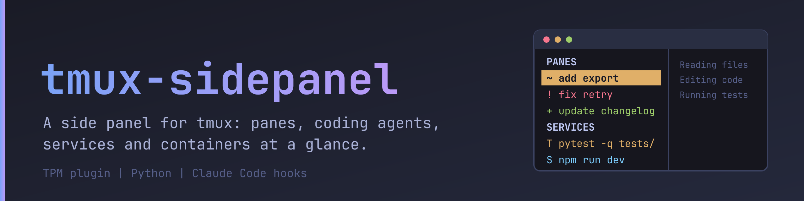
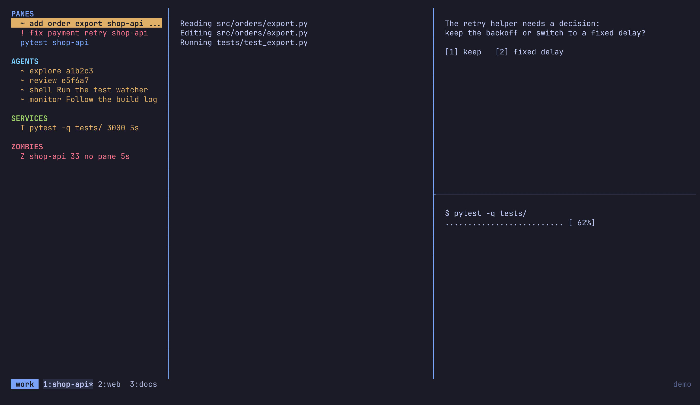
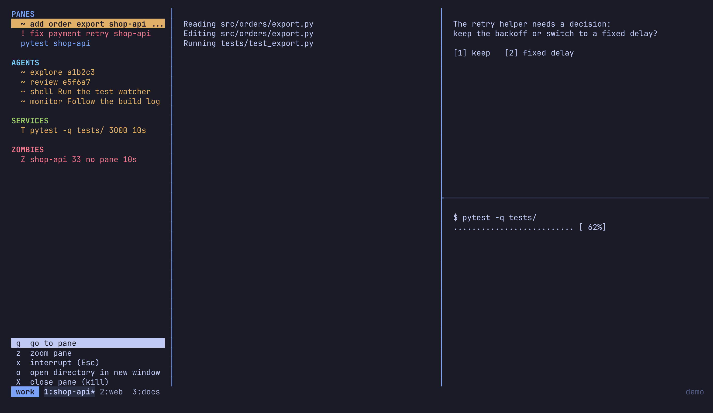

# tmux-sidepanel



A side panel for tmux. Each window gets a panel pane that shows what runs in that window:

- the panes of the window, with the state of the coding agent in each pane
- the subagents of those agents, and the background tasks of the session (commands, monitors,
  workflows, scheduled tasks)
- services (test runners, dev servers, containers) and the containers of other projects
- agent processes that no pane shows any more ("zombies")
- sections of your own, filled by a command you choose

Every row has an action menu: go to a pane, zoom it, interrupt it, stop or restart a service,
read the logs of a container, terminate a zombie or resume its session. Every section can be
turned off, renamed, reordered and given other keys.

The panel needs Python 3.11 or newer and no other packages. It is developed and tested with
tmux 3.7. The hooks use arrays of hooks, which need tmux 3.0 or newer.

## Screenshots

The panel on the left shows the panes of the window with the state of each coding agent, its
subagents, the services that run in the window and an agent process that no pane shows.



Press Enter on a row, or click it with the right mouse button, to open its menu. The menu opens
at the bottom of the panel.



The screenshots show invented data only.

## Install

With the tmux plugin manager, add this to `tmux.conf` and press prefix + I:

```tmux
set -g @plugin 'stevendejongnl/tmux-sidepanel'
```

Without the plugin manager, clone the repository and run its entry file from `tmux.conf`:

```tmux
run-shell '~/.tmux/plugins/tmux-sidepanel/tmux_sidepanel.tmux'
```

The entry file installs the tmux hooks and the key bindings. It is safe to run again.

### Report the state of your coding agent

The panel shows the state of an agent (`working`, `idle`, `blocked`, `done`) only when the agent
reports it. For Claude Code the repository is a plugin that does this with its hooks:

```
/plugin marketplace add stevendejongnl/tmux-sidepanel
/plugin install tmux-sidepanel@tmux-sidepanel
```

The hooks run `python3 -m tmux_sidepanel hook <action>`. They never block the agent: a problem
prints one line and the command still ends with code 0.

The panel reads the pane option `@sidepanel_state` and the options next to it.
Remove any other hook that reports the state of the agent to tmux under other option names, or
the panel stays empty. Point such a hook at `python3 -m tmux_sidepanel hook <action>` instead.

## Use

| Key | Effect |
|-----|--------|
| prefix + S | Open the panel of this window, or close it |
| prefix + F | Move the focus into the panel, or back to the pane you came from |

In the panel:

| Key | Effect |
|-----|--------|
| `j`, Down | Select the next row |
| `k`, Up | Select the previous row |
| Enter | Open the menu of the row |
| a menu key | Run that action |
| Esc | Close the menu |
| `y` | Confirm a question. Any other key cancels it. |
| `q` | Close the panel |

The mouse works when tmux has `set -g mouse on`:

| Mouse | Effect |
|-------|--------|
| Left click on a row | Select the row |
| Right click on a row | Select the row and open its menu |
| Click on a menu item | Run that action |
| Click anywhere else while a menu is open | Close the menu |

Each section has its own color: the title and the rows that have no state are blue for `panes`,
cyan for `subagents`, green for `services`, red for `zombies` and magenta for `custom` sections.
The color of a state (red, green, yellow or magenta) wins over the color of the section.

Actions that cannot be undone (close a pane, stop a service, terminate or kill a process) ask
first. Before a signal is sent to a process, the process is looked up again, so a process
identifier that was reused by something else is never signalled.

A state is shown with a mark in front of the row:

| State | Mark |
|-------|------|
| `blocked` | `!` |
| `done` | `+` |
| `working` | `~` |
| `idle` | `.` |
| `unknown` | `?` |

### Change the keys

Set these tmux options before the plugin loads. The value `off` turns a key off. A key that you
already use for something else is never taken over.

```tmux
set -g @sidepanel_toggle_key 'S'
set -g @sidepanel_focus_key 'F'
```

## Control panes and agents from a script

The command `tmux-sidepanel` prints JSON, so a script or another coding agent can use it. For
Claude Code, the plugin puts the command on the path and adds the skill `tmux-agents`, which
explains it. Without the plugin, run `python3 -m tmux_sidepanel` instead.

```
tmux-sidepanel list --agents
tmux-sidepanel current
tmux-sidepanel get <pane-or-name>
tmux-sidepanel pane split --direction right
tmux-sidepanel pane run <pane> "just test"
tmux-sidepanel pane read <pane> --lines 50
tmux-sidepanel pane wait-output <pane> --match passed --timeout 60000
tmux-sidepanel agent start reviewer --pane <pane> --kind claude
tmux-sidepanel agent prompt reviewer "Review the diff" --wait --timeout 120000
```

A command prints `{"result": ...}` and exits with code 0, or prints
`{"error": {"code": ..., "message": ...}}` on standard error and exits with code 1. The code is
stable. Some commands refuse on purpose: a prompt to an agent that waits for an approval, closing
the pane of the caller, and starting a program that is not a configured agent.

## Configuration

The file is `configuration.toml` in `$XDG_CONFIG_HOME/tmux-sidepanel/`, or in
`~/.config/tmux-sidepanel/`. A file named `config.toml` is read when it is the only one. Without
a file, the defaults apply. A mistake in the file is reported with the name of the key.

The file can run commands (custom sections), so it is refused when someone else owns it or can
write to it.

```toml
[panel]
width = 30              # 10 to 120 columns
refresh_seconds = 0.5   # 0.1 to 60
position = "left"       # left or right

[agents]
names = ["claude"]                          # program names that count as an agent
ignored_arguments = ["--chrome-native-host"]

[[sections]]
type = "panes"

[[sections]]
type = "subagents"
hide_when_empty = true

[[sections]]
type = "services"
title = "RUNNING"
row_format = "{letter} {command} {age}"

[sections.menu]
disabled_actions = ["kill"]

[sections.menu.keys]
stop = "s"

[[sections]]
type = "zombies"
hide_when_empty = true

[[sections]]
type = "custom"
identifier = "ports"
title = "PORTS"
command = ["ss", "-tlnH"]
timeout_seconds = 2
```

Sections are shown in the order of the file. Without a `[[sections]]` table, all default
sections are shown.

### Section types

| Type | Shows | Actions (default key) |
|------|-------|-----------------------|
| `panes` | The panes of the window | go (g), zoom (z), interrupt (x), directory (o), close (X) |
| `subagents` | The subagents and background tasks of the agents | go (g), tasks (t) |
| `services` | Services started from the panes of the window, and its containers | go (g), stop (x), restart (r), logs (l), directory (o), kill (X) |
| `other-services` | Containers that do not belong to this window | stop (x), restart (r), logs (l), directory (o), kill (X) |
| `zombies` | Agent processes that no pane shows | open (o), terminate (x), directory (d), kill (X) |
| `custom` | The lines that your command prints | none |

Every section accepts `identifier`, `title`, `enabled`, `hide_when_empty`, `empty_text`,
`row_format` and a `menu` table with `disabled_actions` and `keys`. The placeholders of a row
format depend on the type, and an unknown placeholder is an error.

The `services` section also takes `rules` (a kind and a pattern for each), `shims` (wrapper
prefixes to remove from a command) and `letters` (the letter that shows each kind).

## Security

- Programs are started from a list of arguments, never through a shell. Container names are
  checked before they are used, and the words of a resume command are quoted for the shell.
- Text from other programs is cleaned before it reaches the screen, so a process name cannot
  send escape sequences to your terminal.
- The panel never asks for, reads or stores a password or a token.

See `SECURITY.md` to report a problem.

## Development

```
uv sync
uv run pytest
uv run ruff check .
uv run ruff format --check .
uv run complexipy src devtools tests --failed --plain
```

The tests that use tmux start their own server on a private socket. They are skipped when tmux
is not installed.

Commits follow Conventional Commits. Releases are made from the tags.

Every change updates the docs and the screenshots. `devtools/screenshots/make.sh` makes the
pictures in `assets/` again from a demo tmux that holds invented data. See `CONTRIBUTING.md`.

## License

AGPL-3.0-or-later. See `LICENSE`.
